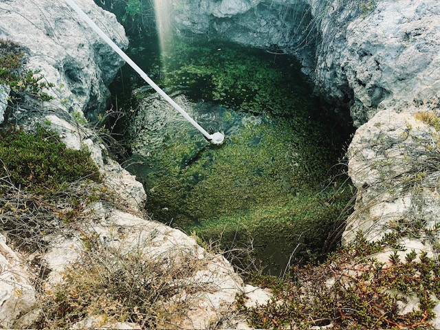

# Aloha!  E komo mai!

## Dr. Olivia George

### BIO

### EDUCATION

### TEACHING
Olivia enjoys teaching: 
* cell biology
* molecular biology
* genetics
* biochemistry

### RESEARCH
#### Microbial Life in Anchialine Pools

### MY LINKS
Find me at [Github](https://github.com/OGeorge01)
